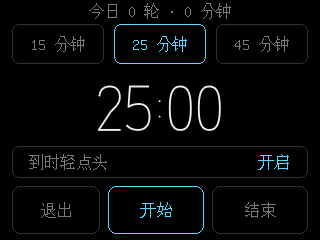
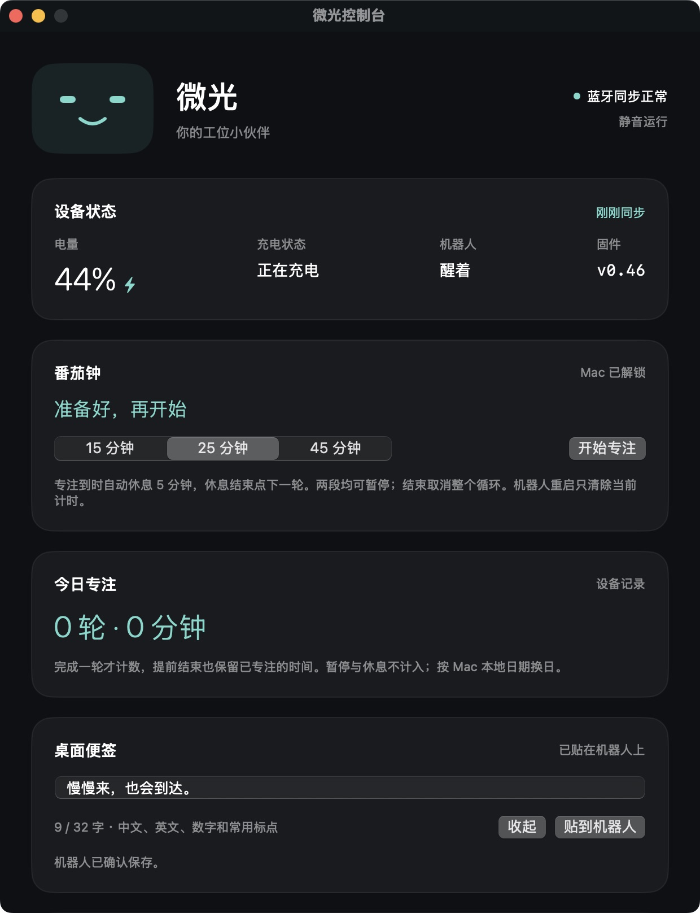

# 微光 · Weiguang


简体中文 | [English](README_EN.md)

让桌上的 StackChan 陪你写代码：看看哪些任务在跑、哪里需要回应，摸摸头，再安静地专注一会。

微光包含机器人固件、Mac 本地同步桥接和原生控制台。使用 USB 或蓝牙同步，日常无需 Wi-Fi，不调用云端模型；读取本机 Codex 会话来显示状态，因此不额外消耗模型 API 额度。它是个人开发项目，与 M5Stack、OpenAI 无隶属关系。

**v0.46 实验版。** 已在开发设备上部署：Mac 贴上／收起／恢复、设备显示和重启保留已检查。长按手感、更多设备与长时间稳定性仍欢迎实测反馈。

## 看一眼


真实设备帧缓冲：猫系表情与示例便签。它不是效果图或机器人外观照片。

<details>
<summary>番茄钟准备页与 Mac 控制台</summary>




</details>

另附[实际绘图代码生成的番茄钟预览](docs/preview/focus.png)，使用示例时间，和上面的实机截图区分。

## 能做什么

- **任务一眼可见**：自动显示最近活跃的最多 8 个会话，区分运行、待回应、完成与中断，显示简短进展和结果摘录。
- **安静提醒**：待回应时用琥珀色提示和表情变化；按住提示区域约 0.9 秒即请求 Mac 打开对应 Codex 对话，无需松手。普通任务提醒默认不动电机。
- **桌面陪伴**：默认脸与猫系脸可切换，摸头害羞、小幅点头、慢眨眼、打哈欠、闭眼休息。休息不自动降低亮度，摸头或触屏可唤醒。
- **沉浸番茄钟**：15／25／45 分钟，细线数字与进度圆环；专注结束进入 5 分钟休息，下一轮由你手动开始。待回应仅亮小点，不暂停计时。
- **今日专注小结**：统计实际专注时长与完整轮数，保存在设备。暂停和休息不计入。
- **桌面便签**：Mac 写一条最多 32 字的短句，机器人以暖黄色纸张样式显示，带轻微纸纹、阴影和折角；长按收起，控制台可重新贴上。待回应提示优先，番茄钟不被便签覆盖。
- **两端设置同步**：亮度、外观、日常表情、休息与独立动作开关共用设备保存的设置；Mac 登录后同步服务自动运行。

## 开始之前

当前开发目标是 **M5Stack StackChan K151（CoreS3 / ESP32-S3，16 MB Flash）与 macOS 12+**，不承诺兼容其他硬件。开发需要 Python 3.9+、Xcode Command Line Tools、PlatformIO，以及一根可传数据的 USB-C 线。Mac 控制台以中文为主。

本项目替换原厂应用固件，当前不包含原厂 AI Agent／语音对话。**第一次刷写前先保存自己的完整原厂备份、分区表和校准数据。不要使用别人的整片 Flash 备份。** 目前没有签名、公证的 Mac 安装包，也没有预编译固件下载。

### 1. 构建

```sh
python3 -m venv .venv
.venv/bin/python -m pip install platformio==6.2.0
.venv/bin/python -m pip install --no-index --require-hashes -r bridge/requirements.txt --find-links bridge/wheels
.venv/bin/pio run
python3 macos/build.py
python3 macos/build_icon.py
python3 macos/build_panel.py
```

PlatformIO 首次构建需联网下载固定版本依赖。Swift 构建脚本生成 Apple Silicon / Intel 通用开发二进制，使用本机临时签名；不等同于 Developer ID 签名或公证发行包。详见 [开发说明](docs/DEVELOPMENT.md)。

### 2. 备份与刷写

先阅读 [硬件与刷写边界](docs/HARDWARE.md)。应用镜像位于 `.pio/build/stackchan/firmware.bin`。已验证的开发设备仅更新 `0x10000` 处的应用，保留其原有分区、NVS 和舵机校准；**不要直接使用 PlatformIO 的全套 upload 或 erase_flash 作为通用安装步骤**。不同出厂布局需要先核对，当前不提供一键刷机。

### 3. 安装 Mac 同步

机器人已刷入兼容固件并通过 USB 连接后：

```sh
./weiguang install
./weiguang status
./weiguang panel
# 一次 USB 绑定后，可用蓝牙日常同步
./weiguang bind-bluetooth
```

系统弹出蓝牙访问请求时允许「微光蓝牙」。服务只在当前用户下安装，无需 sudo。USB 可以继续供电；蓝牙同步不依赖办公室 Wi-Fi。

## 常用操作

| 操作 | 结果 |
| --- | --- |
| 轻点主屏 | 查看任务列表；滑动浏览 |
| 待回应卡片按住约 0.9 秒 | 请求 Mac 打开该对话，不自动回复 |
| 轻摸头 | 表情回应；是否点头由设置决定 |
| 番茄钟轻点 | 显示暂停、继续、退出和结束按钮 |
| 番茄钟「退出」 | 回到主屏，计时继续 |
| 番茄钟「结束」 | 取消当前专注／休息循环 |
| `./weiguang pause` / `resume` | 暂停／恢复同步，暂停状态跨登录保留 |
| `./weiguang diagnostics` | 导出不含聊天正文与密钥的诊断摘要 |

详细说明：[日常使用](DAILY_USE.md) · [换电脑](MIGRATION.md) · [隐私与局限](docs/PRIVACY.md)。

## 验证与限制

开发源码通过 122 项 Python 测试、27 组 C++ 检查以及固件和原生开发构建。公开副本的验证结果记录在 [开发说明](docs/DEVELOPMENT.md)；自动测试不替代触摸手感、无线环境、长时间运行和真实断电验收。

任务读取依赖 Codex 当前本地数据库与事件格式，不是稳定公开 API。无法读取时展示同步异常，不把旧快照伪装为实时数据。离线时表情、设备设置和本地番茄钟仍可运行，任务更新和打开对话需要 Mac 连接。

[更新日志](CHANGELOG.md) · [第三方来源](THIRD_PARTY.md)

## 许可证

原创部分采用 [MIT](LICENSE)。第三方驱动和 pyserial 分别保留其许可证；M5GFX、M5Unified、Arduino-ESP32 由构建工具按指定版本获取。
